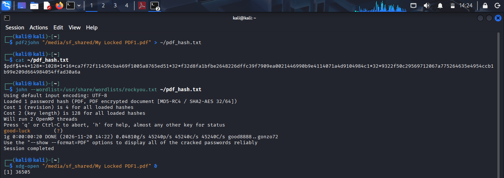
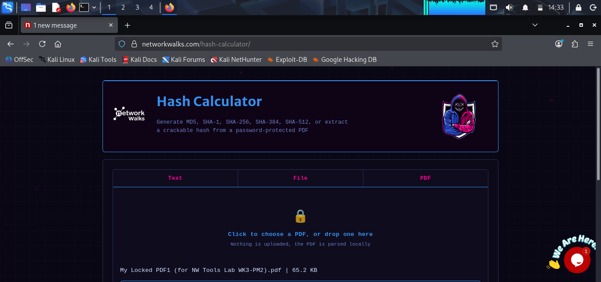
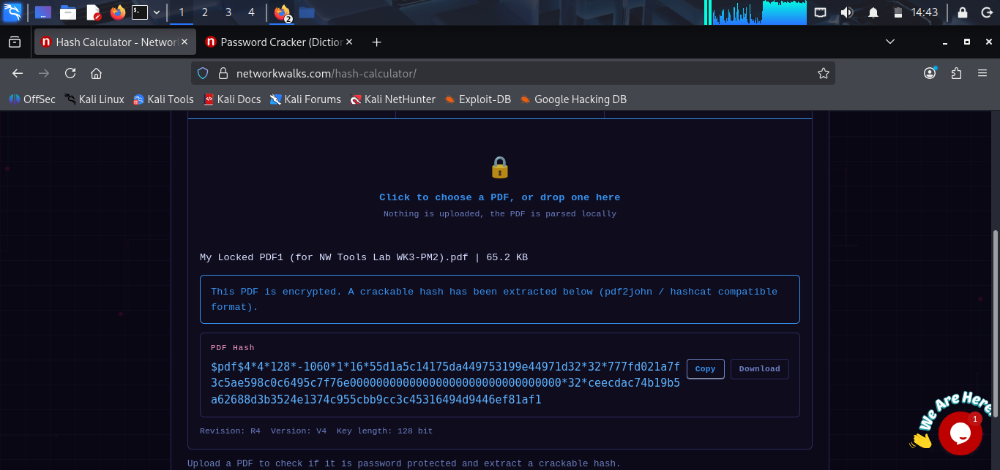
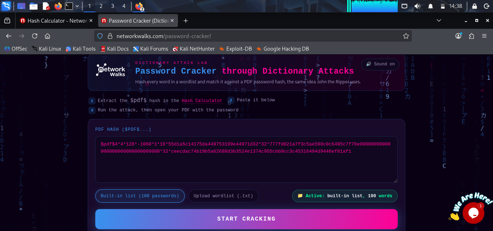
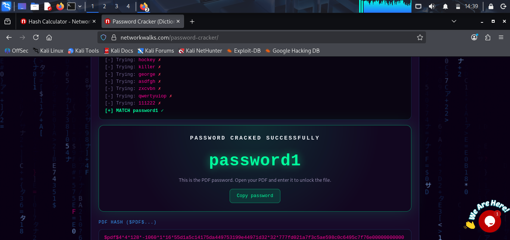

# NETWORKWALKS-ABUUBAKAR-B084-WK3-PM1-2--PASSWORD-CRACKING-WITH-JTR-NW-TOOLS
Password Cracking with JtR and Networkwalks Tools Hands-on ethical hacking project tasks focused on testing and auditing password strength using John the Ripper (JtR) and Networkwalks tools to identify weak credentials and improve system security.


# 🔐 Password Cracking & PDF Analysis Report Using John the Ripper (JtR)

## 📋 1. Executive Summary

This report documents how a password hash was extracted from a locked PDF file (`/media/sf_shared/My Locked PDF1.pdf`) on **Kali Linux** inside Oracle VirtualBox, cracked using **John the Ripper (JtR)** and the `rockyou.txt` wordlist, opened in a PDF viewer, and used to capture the final flag (`nw{cybersecurity_flag_captured_2608}`).

| 📌 Parameter | 📄 Details |
| :--- | :--- |
| **Target File** | `/media/sf_shared/My Locked PDF1.pdf` |
| **Environment** | Kali Linux (VirtualBox) |
| **Hash Extraction Tool** | `pdf2john` |
| **Cracking Tool** | John the Ripper (`john` / JtR) |
| **Wordlist Used** | `/usr/share/wordlists/rockyou.txt` |
| **Cracked Password** | `good-luck` |
| **Cracking Duration** | 20 seconds (`0:00:00:20`) |
| **Captured Flag** | `nw{cybersecurity_flag_captured_2608}` |

---

## 🛠️ 2. Prerequisites & Environment Setup

### 🔄 2.1 Updating / Upgrading John the Ripper

Before running the cracking workflow, update the package index and upgrade `john`:

```bash
sudo apt update && sudo apt install --only-upgrade john -y
```

**Command explanation:**

- `sudo`: Runs commands with administrator privileges.
- `apt update`: Refreshes the package list.
- `&&`: Runs the second command only if the first succeeds.
- `apt install --only-upgrade john -y`: Upgrades John the Ripper and automatically confirms the installation.

### 📂 2.2 Extracting the `rockyou.txt` Wordlist

In Kali Linux, `rockyou.txt` is normally stored in compressed form as `rockyou.txt.gz`.

Decompress it using:

```bash
sudo gunzip /usr/share/wordlists/rockyou.txt.gz
```

**Command explanation:**

- `sudo`: Runs the command with administrator privileges.
- `gunzip`: Decompresses the compressed wordlist.
- The resulting file is `rockyou.txt`.

---

## 💻 3. Terminal Execution & Observations

### 🔹 Step 1: Extracting the PDF Hash

```bash
pdf2john "/media/sf_shared/My Locked PDF1.pdf" > ~/pdf_hash.txt
```

This extracts the encryption hash from the PDF and saves it in `pdf_hash.txt`.

### 🔹 Step 2: Inspecting the Extracted Hash

```bash
cat ~/pdf_hash.txt
```

This displays the extracted PDF hash in the terminal.

### 🔹 Step 3: Cracking the PDF Password

```bash
john --wordlist=/usr/share/wordlists/rockyou.txt ~/pdf_hash.txt
```

John the Ripper performs a dictionary attack using the `rockyou.txt` wordlist.

**Observed results:**

- One PDF hash was successfully loaded.
- John the Ripper used two OpenMP threads.
- The password was recovered as **`good-luck`**.
- Cracking duration: **20 seconds**.
- Session status: `Session completed`.

### 📸 Terminal Execution Screenshot

The following screenshot shows the hash extraction, hash inspection, password cracking process, and PDF viewer command.



---

## 🎉 4. Final Result & Flag Capture

### 🔹 Step 4: Opening the Protected PDF

```bash
xdg-open "/media/sf_shared/My Locked PDF1.pdf" &
```

This opens the PDF using the default PDF viewer.

The `&` symbol allows the process to run in the background.

### 📸 Unlocked PDF Screenshot

The following screenshot shows the successfully unlocked PDF document and the captured flag.


### 🏆 Final Results

- **Document Status:** Successfully opened.
- **PDF Pages:** 1 of 1.
- **Recovered Password:** `good-luck`.
- **Confirmation Message:** "Congratulations! You have captured your flag."

### 🚩 Captured Flag

```text
nw{cybersecurity_flag_captured_2608}
```

---

### ⚠️ 2.3 Troubleshooting & Dependency Resolution: `pyhanko`

#### 📌 Issue Overview
During hash extraction with `pdf2john`, an issue can arise if the **`pyhanko`** Python dependency is missing, incomplete, or restricted by system-level Python package policies on Kali Linux. When `pyhanko` is not properly configured, `pdf2john` may fail to parse encrypted PDF structures or fail to generate a valid hash output.

* **[Picture Placeholder: Insert screenshot here — showing any `pyhanko` / `pdf2john` error or verification check if applicable]**

#### 🛠️ Diagnostic & Resolution Matrix

| 🔍 Finding / Risk | 💻 Action / Command Placeholder | 🎯 Technical Purpose | ✅ Verification & Expected Outcome |
| :--- | :--- | :--- | :--- |
| **Missing or unverified `pyhanko` module** | **[Command Placeholder: `python3 -c "import pyhanko; print('pyhanko is ready')"`]** | Verifies whether Python can import `pyhanko` cleanly in the current environment. | Outputs `pyhanko is ready` with zero `ModuleNotFoundError` messages. |
| **Incomplete or blocked installation** | **[Command Placeholder: `sudo apt update && sudo apt install -y python3-pyhanko || pip install --upgrade --break-system-packages pyhanko`]** | Installs or upgrades `pyhanko` via `apt`, falling back to `pip` (`--break-system-packages`) if restricted by Kali's managed Python environment. | Completes installation cleanly and passes the `pyhanko` import verification check. |
| **Hash extraction after remediation** | **[Command Placeholder: `pdf2john "/media/sf_shared/My Locked PDF1.pdf" > ~/pdf_hash.txt`]** | Re-runs hash extraction on the target PDF once `pyhanko` is confirmed working. | Generates a valid `$pdf$...` hash string inside `~/pdf_hash.txt` without errors. |

#### 📝 Reporting Note
Resolving `pyhanko` prior to hash extraction ensures consistent `pdf2john` behavior across encrypted PDFs and prevents avoidable workflow interruptions during assessment or lab documentation.
---

## ✅ 5. Conclusion

The exercise was successfully completed using John the Ripper.

The PDF encryption hash was extracted using `pdf2john`, and the password was recovered using John the Ripper with the `rockyou.txt` wordlist in approximately 20 seconds.

Finally, the protected PDF was successfully opened, revealing the congratulatory message and the final flag.

**Practical skills demonstrated:**

- PDF hash extraction.
- Password cracking using John the Ripper.
- Dictionary attacks using `rockyou.txt`.
- Linux command-line operations.
- PDF password recovery and analysis.

---

# 🔐 PDF Password Cracking Using Networkwalks Online Tools

## 📋 1. Executive Summary

This report documents a PDF password-cracking exercise performed using two free online tools developed by **Networkwalks**: the Hash Calculator and Password Cracker.

During this exercise, a password hash was extracted from a locked PDF file using the Hash Calculator. The extracted hash was then analyzed by the Password Cracker, where the original password was successfully recovered.

Both tools were accessed through a web browser, so no additional software installation was required.

This practical exercise demonstrated how password hashes can be extracted and how dictionary-based password-cracking techniques can be used to recover passwords. It also highlighted the importance of using strong passwords to protect sensitive documents.

---

## 🛠️ 2. Tools & Resources Used

| 📌 Tool | 🎯 Purpose |
| :--- | :--- |
| **Networkwalks Hash Calculator** | Used to extract the password hash from the locked PDF file. |
| **Networkwalks Password Cracker** | Used to analyze the extracted hash and recover the original password. |
| **Web Browser** | Used to access both online tools. |
| **Locked PDF File** | Used as the target document for the exercise. |

### 🔗 Online Tools

- **Hash Calculator:** https://networkwalks.com/hash-calculator/
- **Password Cracker:** https://networkwalks.com/password-cracker/

---

## 💻 3. Practical Execution & Observations

### 🔹 Step 1: Accessing the Hash Calculator

The Networkwalks Hash Calculator was accessed through a web browser using the following URL:

https://networkwalks.com/hash-calculator/

The online tool was successfully loaded, and the locked PDF file was prepared for hash extraction.

### 📸 Screenshot 01 – Hash Calculator



---

### 🔹 Step 2: Extracting the PDF Hash

The locked PDF file was uploaded to the Hash Calculator, where its encryption hash was automatically extracted.

The generated hash was displayed with the `$pdf$` prefix, indicating that the extracted value was associated with PDF document encryption.

The complete hash value was copied for use in the next stage of the exercise.

**Observation:**

- The PDF file was successfully processed.
- An encryption hash beginning with `$pdf$` was generated.
- The complete hash value was obtained for further analysis.

### 📸 Screenshot 02 – Extracted PDF Hash



---

### 🔹 Step 3: Accessing the Password Cracker

The Networkwalks Password Cracker was accessed through the following URL:

https://networkwalks.com/password-cracker/

The online password-cracking interface was successfully opened, and the previously extracted PDF hash was prepared for analysis.

### 📸 Screenshot 03 – Password Cracker Interface



---

### 🔹 Step 4: Performing the Password-Cracking Process

The extracted hash was pasted into the Password Cracker, and the cracking process was initiated.

During the process, different password combinations were tested against the supplied hash until a matching password was identified.

The process was allowed to continue until the tool completed its analysis.

**Observation:**

- The extracted PDF hash was successfully submitted.
- Password combinations were tested by the online tool.
- The original password was identified after the cracking process was completed.

**Note:** The time required for password recovery may vary depending on the complexity of the password and the capabilities of the cracking tool.

### 📸 Screenshot 04 – Recovered Password



---

### 🔹 Step 5: Unlocking the Protected PDF

After the password had been recovered, the original locked PDF document was opened.

The recovered password was entered into the PDF password prompt, and access to the protected document was successfully granted.

This confirmed that the password obtained through the Networkwalks Password Cracker was valid.

### 📸 Screenshot 05 – Successfully Unlocked PDF


---

## 🎉 4. Final Results

The exercise was successfully completed using the two Networkwalks online tools.

The following results were obtained:

- **Hash Extraction:** Successfully completed.
- **Hash Format:** PDF encryption hash (`$pdf$`).
- **Password Cracking:** Successfully completed.
- **Password Recovery:** A matching password was identified.
- **PDF Access:** Successfully restored using the recovered password.

---

## ✅ 5. Conclusion

The practical exercise was successfully completed using the Networkwalks Hash Calculator and Password Cracker.

The encryption hash was extracted from the protected PDF document, and the original password was subsequently recovered through the online password-cracking tool.

Finally, the recovered password was used to unlock the PDF document, confirming the successful completion of the exercise.

**Practical skills demonstrated:**

- PDF hash extraction.
- Understanding PDF encryption hashes.
- Online password-cracking techniques.
- Hash analysis and password recovery.
- Understanding the importance of strong passwords.
- Using browser-based cybersecurity tools.

